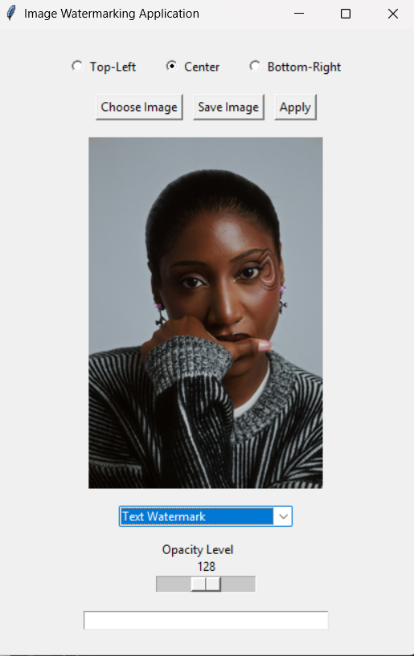
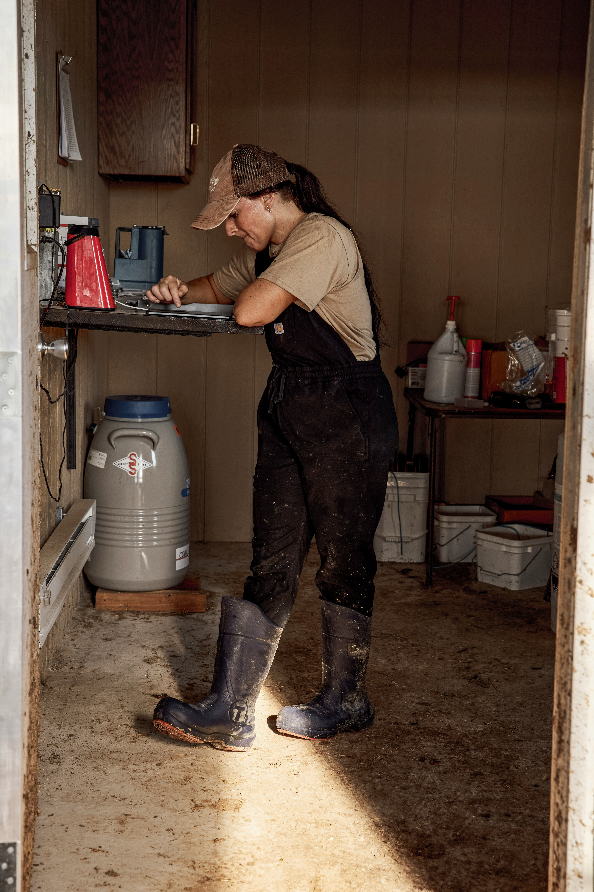
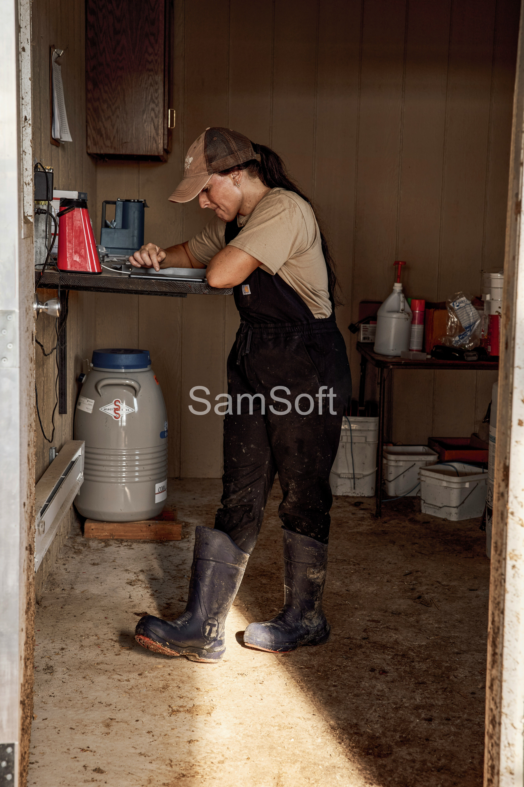

# 🖼️ Desktop Image Watermarking Suite

A lightweight Python desktop application built with Tkinter and Pillow that allows users to apply dynamically scaled, semi-transparent text and logo watermarks while preserving full image resolution.

## 📸 Showcase

| Application Interface | Before | After (Watermarked) |
| :---: | :---: | :---: |
|  |  |  |


## ⚙️ Technical Highlights

* **Full-Resolution Preservation.** The GUI renders a scaled-down clone for smooth previews while keeping the original master image untouched in memory for high-resolution exports.
* **Dynamic Proportional Scaling.** Text font sizes automatically scale to 5% of the image height, and logo overlays scale to 15% of the image width to fit any photo dimension.
* **Non-Destructive Alpha Blending.** Uses RGBA layer compositing for text and pixel-level blending for logos to adjust opacity without ruining transparent PNG backgrounds.
* **Smart File Optimization.** Automatically flattens RGBA channels to RGB and applies compression optimization when exporting JPEGs to prevent massive file sizes.


## 🚀 How to Run Locally

1. **Clone the repository**
   ```bash
   git clone https://github.com/Sammy-Softway/web-dev-showcase.git
   cd gui-image-watermark-app
   ```

2. **Install the required dependency**
   ```bash
   pip install pillow
   ```
   *(Note: `tkinter` comes pre-installed with standard Python distributions).*

3. **Launch the application**
   ```bash
   python main.py
   ```

## 🔮 Future Improvements

* **Color Picker.** Add a Tkinter `colorchooser` dialog so users can pick custom text colors instead of white.
* **Font Selector.** Allow users to choose between different system fonts and styles.
* **Batch Processing.** Enable selecting an entire folder of images to watermark all at once.


## Project Reflection & Takeaways

### 1. What was easy?

Answer: Once I actually got the elements to display on the screen, setting up the basic Tkinter interface and structuring the core layout logic felt pretty intuitive. Breaking the app down into separate, modular functions (like creating a dedicated preview_image tool) made sense early on, and it made updating the user interface a lot cleaner because I didn't have to constantly repeat code.

### 2. What was hard?

Answer: Reading and translating the official documentation was incredibly frustrating at first—it felt like reading a legal contract instead of a helpful guide. Dealing with Tkinter's geometry engine was also a huge headache; elements kept shifting, squeezing, or disappearing completely whenever a new image was loaded. The absolute hardest part, though, was debugging the invisible traps under the hood—like the code editor falsely greying out my save logic because of strict type-checking, or Pillow's .thumbnail() method silently shrinking my high-res master files behind the scenes.

### 3. How I might improve for the next project? / What I would do differently?

Answer: On my next project, I am going to map out the visual layout hierarchy and state transitions on paper before writing a single line of interface code, which will save me from a lot of padding and layout adjustments later. I will also use explicit type hinting right from the start to keep my code editor's background engine from getting confused, and I'll be much more careful about tracking whether an image processing method modifies my data objects in-place or returns a copy.

### 4. What was my biggest learning from today?

Answer: My biggest takeaway was realizing the massive difference between Static Analysis (what the editor thinks is happening before the code runs) and Runtime Reality (what actually happens in memory when a user clicks a button). Learning how to use tools like Image.blend() and .copy() to protect full-resolution master files taught me that software engineering isn't just about making things look right on a screen—it's about managing data channels safely behind the scenes.