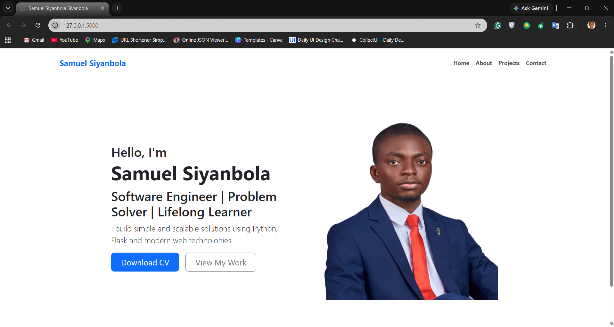

# Professional Portfolio Website

A personal portfolio web application built with Python to showcase my projects, skills, and background. 

## Tech Stack
- **Backend:** Python (Flask)
- **Frontend:** HTML5, CSS3, JavaScript, Bootstrap5

## Features
- Multi-page routing (Home, About, Projects, Contact)
- Responsive layout styled with custom assets in `static/`
- Dynamic HTML rendering using Jinja2 templates in `templates/`

## Project Structure
```text
professional-portfolio/
├── static/          # CSS stylesheets, images, and JavaScript files
├── templates/       # HTML templates
├── main.py          # Application entry point and URL routing
└── README.md        # Project documentation and reflections
```

## How to Run Locally
1. Clone the repository:
   ```bash
   git clone https://github.com/Sammy-Softway/web-dev-showcase.git
   ```
2. Navigate to the project folder:
   ```bash
   cd professional-portfolio
   ```
3. *(Optional)* Create and activate a virtual environment:
   ```bash
   python -m venv venv
   source venv/bin/activate  # On Windows use: venv\Scripts\activate
   ```
4. Install dependencies (e.g., Flask):
   ```bash
   pip install flask
   ```
5. Start the development server:
   ```bash
   python main.py
   ```
6. Open your browser and go to `http://127.0.0.1:5000`.

## Preview




## Future Improvements
- Connect the contact form to an email service or database
- Deploy the application to a cloud hosting platform for a live public URL
- Add interactive filtering for portfolio projects

---


## Project Reflection & Takeaways

### 1. What was easy?

Answer: Initial baseline routing structure.
This is the first clean slate project I've had to work on.
And for a first trial without no prior experience, 
I was able to think through,
and set up the Initial baseline routing structure, without so much struggle.

### 2. What was hard?

Answer: Structure and Approach.
Maybe because it's my first, I struggle to understand the best approach
for measurable progress to achieving the task.

### 3. How I might improve for the next project? / What I would do differently?

Answer: Approach with a Use Case Diagram.

### 4. What was my biggest learning from today?

Answer: Before taking on a project one needs to know
the goal & purpose, Sketch before you code, and Research inspiration.